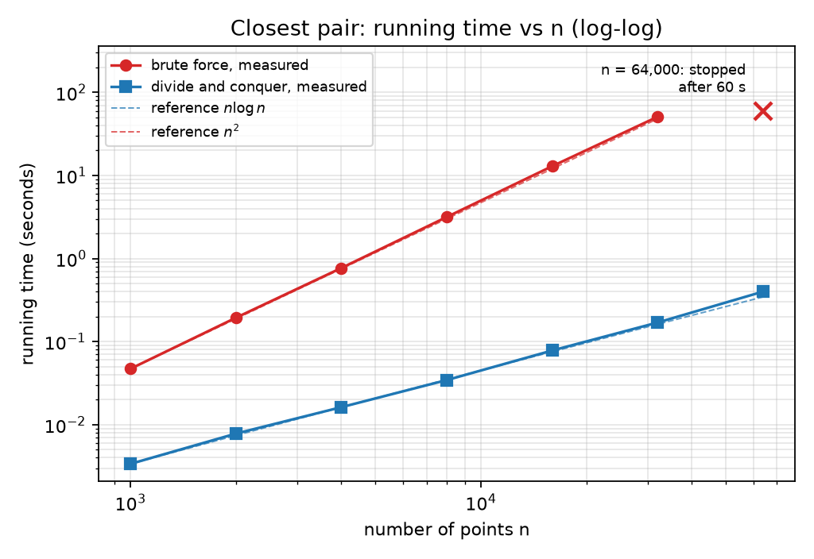
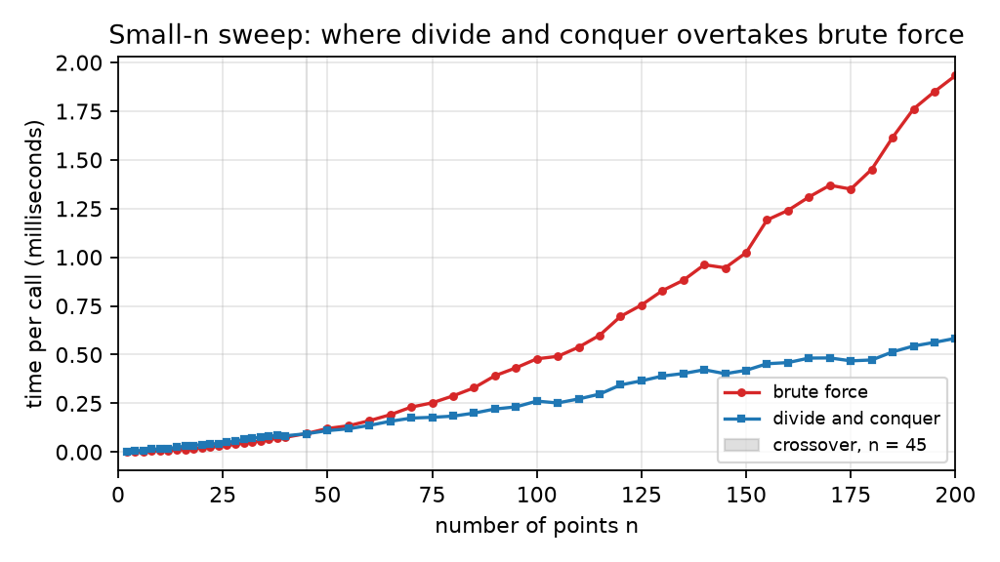

# Assignment 2: Closest Camera Traps

**CSF302, Units 2 to 4** · Name:Karma Namgay Dorji
Student ID:02230284

Files: `closest.py` (Part A), `test_closest.py` (Part B), `benchmark.py` (generates every number and graph in Part C)

---

## 1. Implementation (Part A)

**`closest_pair_brute(points)`** considers all n(n-1)/2 pairs, finds the minimum *squared* distance (without taking the square root within the loop) and returns `(d, i, j)` with `i < j`. Θ(n²).

**`closest_pair(points)`** is divide and conquer:

1. First, sort all points on the x-axis keeping their original indices, since we need to return points sorted according to the calling order.
2. Divide the list into two parts by position, and solve both subproblems recursively. Subproblems that have up to three points will be solved using brute force. Also, each recursive call returns the points sorted according to y, which allows the parent to merge them with O(n) complexity.
3. Where δ is the smallest of the two halves of the answer. Points that have an x coordinate strictly smaller than δ relative to the cutting line (the band of width 2δ) are retained and scanned for y coordinate. The point can only be compared with the later points that lie less than δ above it, with a maximum of 7 such points possible. This is because the δ × 2δ rectangle above the point divides into 8 boxes of size (δ/2)², and each box can contain only one point.

*Why checking the strip is enough.* Two points whose separation is less than δ, with one point on either side, will have x ≤ mid x ≤ right x and right x - left x < δ. This means that both points are less than δ from the line and are thus in the strip.

---

## 2. Testing (Part B)

`python -m unittest -v test_closest` runs **23 tests, all passing** (about 1 second).

| Requirement | Tests | What they check |
|---|---|---|
| ≥ 500 random inputs, 2 to 50 points | `test_600_random_inputs` (200 each of: tiny integer grid with many ties, wide integer range, floats), plus every size 2..50 × 10 | `closest_pair` distance equals brute force; indices satisfy `0 ≤ i < j < n` and really give distance `d`; input list is not modified |
| Exactly 2 points | 4 tests | normal, reversed x-order, brute force, and `ValueError` for 0 or 1 points |
| Duplicate points (answer 0) | 6 tests | two identical, duplicate among others, three copies, all points identical, **duplicates split by the dividing line**, 100 random inputs with a planted duplicate |
| All on one vertical line | 4 tests | small hand-checked case, 100 random lines, 800 points on a line, horizontal line |
| Closest pair on opposite sides of the dividing line | 4 tests | hand-built example, same example shuffled, **200 random lattice instances** with one planted straddling pair (the test first asserts each half alone is *worse*, so the case is genuine), points lying exactly on the dividing line |

The whole suite tests over 1,600 cases against brute force. The suite also validates the case from the brief, which provides `(1.414…, 0, 5)`.

**Do the tests catch real bugs?** I ran the suite against four deliberately broken copies of `closest.py`. All four were detected.

| Broken version | Failing tests |
|---|---|
| strip check removed | 12 |
| strip scans only the adjacent point | 12 |
| strip keeps only the left side | 3 |
| strip too narrow (δ/2) | 3 |

---

## 3. Analysis (Part C)

### 3.1 Recurrence and Master Method

For n > 3, the work done outside the recursive invocations is as follows: cutting in half Θ(n), merging using y Θ(n), stripping Θ(n), and checking the strip ≤ 7n comparisons = Θ(n). Hence

**T(n) = 2 T(n/2) + Θ(n)**, with T(n) = Θ(1) for n ≤ 3.

Master Method: a = 2, b = 2, f(n) = Θ(n). Then n^(log_b a) = n^(log₂ 2) = n, so f(n) = Θ(n^(log_b a)), which is **Case 2**, giving **T(n) = Θ(n log n)**.

Proof by recursion tree: At level k there are 2^k subproblems of size n/2^k, with cost c*n per level for log₂ n levels = c*n*log₂ n. The single upfront sorting is Θ(n log n), and hence the total is Θ(n log n).

(If we sort the strips based on y coordinates instead of doing the merge, we get T(n) = 2T(n/2) + Θ(n log n) = Θ(n log²n). This is why we have the merge.)

Brute force: exactly n(n−1)/2 comparisons, so T(n) = Θ(n²).

### 3.2 Timing results

Setup: n random points uniformly distributed in [0, 10 000]², fixed seed values. Same points for both algorithms; results have been compared for those sizes where both computations completed successfully. Time reported is the **best of k runs** (k = 9 for divide and conquer, 5/3/2/1 for brute force depending on n) with garbage collection paused, as `timeit` does, because other programs can only make a run slower. Brute force algorithm works in the child process which is killed after 60 seconds.
Machine: Python 3.13.18 (CPython), Linux x86_64, 2 logical CPUs (Intel Xeon 2.1 GHz).

| n | Brute force (s) | Divide and conquer (s) | Speed-up | D&C time / (n log₂ n) (µs) |
|---:|---:|---:|---:|---:|
| 1,000 | 0.033 | 0.0029 | 11× | 0.291 |
| 2,000 | 0.132 | 0.0063 | 21× | 0.287 |
| 4,000 | 0.517 | 0.0134 | 39× | 0.280 |
| 8,000 | 1.968 | 0.0263 | 75× | 0.254 |
| 16,000 | 9.878 | 0.0665 | 148× | 0.298 |
| 32,000 | 39.773 | 0.1585 | 251× | 0.331 |
| 64,000 | > 60 (stopped) | 0.2919 | n/a | 0.286 |



*Figure 1. Dashed lines are n² and n log n reference curves starting from the first data point. Log-log fits: brute force 2.05, divide and conquer 1.13.*

### 3.3 Crossover point

The two functions were both timed using values of n from 2 to 400 (10 random values per n).



*Figure 2. Time per call for small n.*

Divide and conquer is **first faster at n = 60** and **faster at every tested n from 75 upwards**. Between about 50 and 70 the two curves are within about 10% of each other, and the run at n = 70 is a noise blip. **The crossover on this machine is therefore n ≈ 60 to 75.** At n = 40 brute force takes 0.055 ms against 0.068 ms. At n = 100 the order has reversed, 0.304 ms against 0.188 ms.

---

## 4. Critical Reflection (Questions 1, 2 and 3)

**1. Did the measured growth match the recurrence?** Yes. The slope for brute force was 2.05, and the factor of increase with doubling n was 4.16 (theoretical 4). The slope for divide and conquer was 1.13, and the doubling factor was 2.17. The doubling factor for n log n is 2.13-2.20 and the slope locally is 1+1/ln(n) = 1.11; the difference from 1 is the log factor. Time divided by n log₂ n varies between 0.25 and 0.33 µs for a 64-fold increase of n. There are discrepancies: the brute force algorithm took 5.0× more time for n = 16,000 compared to 8,000 (possible CPU cache effects, unverified), and the computer is noisy (a function call fluctuates by up to 2.2×). This is why I use best-of-k times, and this is why the time for n=32,000 for brute force (one measurement) should be taken with caution.

**2. Why is brute force faster for small n although it is Θ(n²)?** The big-O notation doesn’t consider the constant terms. The inner loop of the brute force algorithm takes roughly 65 ns per pair. The divide and conquer algorithm requires around 0.29 µs per n·log₂n for tuple sorting, list slicing, recursion, merge and construction of the strip list. 65 ns · n(n−1)/2 = 0.29 µs · n·log₂n gives n = 48, close to the actual range of 60 to 75 (where the model excludes the lower-order terms). Below which, n² is insignificant. Base case greater than 3 would decrease the crossover point.

**3. Which edge case was hardest, and how did testing help?** A vertical line, and duplicates. Partitioning on x coordinate will lead to an empty half in case all x coordinates are equal, therefore I partitioned on position. Using `<` in the strip test, and duplicates (δ = 0), the strip will be empty and 0 will be returned. Using a small integer grid (coordinate from 0 to 6) will ensure that a lot of ties, duplicates and identical x values will be created due to the random tests and the straddle test will first check that both halves separately are not better than the solution.

---

## 5. How to reproduce

```
python -m unittest -v test_closest     # Part B, 23 tests
python benchmark.py                    # Part C: tables, graphs, crossover (about 4 to 6 minutes)
```

`benchmark.py` writes `results_scaling.csv`, `results_crossover.csv`, `timing_loglog.png` and `crossover.png`. Absolute times depend on the machine; the growth rates and the shape of the graphs do not.