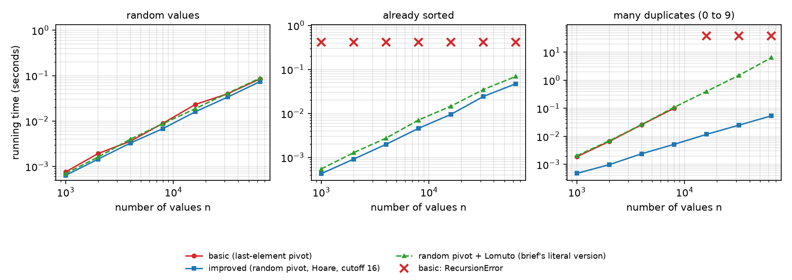
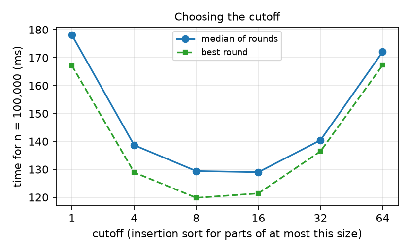

# Assignment 3: Fixing a Slow Quicksort

**CSF302, Unit 5** · Name:Karma Namgay Dorji· Student ID: 02230284

Files: `sorts.py` (Part A), `test_sorts.py` (Part B), `benchmark.py` (produces every number and graph in Part C)

---

## 1. Implementation (Part A)

**`quicksort_basic(a)`**: Quicksort recursive, Lomuto partition scheme, last element is pivot. Average Θ(n log n).

**`quicksort_improved(a, cutoff=16)`** sorts in place and has four changes:

1. **Random pivot**, so no fixed input order (such as "already sorted") can force bad splits.
2. **Recurse on the smaller part, loop on the larger part.** The smaller part has at most half the elements, so the recursion depth is at most log₂ n.
3. **Insertion sort for parts of at most `cutoff` elements.**
4. **Hoare partition** (my addition, see below).

*Why a fourth change?* A random pivot solves problem for sorted inputs but **not** for inputs with many duplicates: Lomuto partition splits all equal values into one partition, therefore, for the sorted block of duplicates, the runtime is quadratic (in terms of 3.1). In Hoare partitioning, both pointers will stop at any value that is equal to the pivot, and they swap them, therefore, duplicates partition will be divided in half. The literal interpretation of the brief (random pivot with Lomuto) is`quicksort_improved(a, partition="lomuto")` so I can measure the difference. Neither function calls `sorted()` or `list.sort()`; both return `None`.

---

## 2. Testing (Part B)

`python -m unittest -v test_sorts` runs **33 tests, all passing** (about 4 s). Each test is performed on 8 versions (original, enhanced with cut-off at 1, 2, 5, 16, 64, and Lomuto cut-off 1 and 16). The performance is compared to`sorted()` on a copy; it also checks that the list is sorted in place and `None` is returned.

| Requirement / extra | What is tested |
|---|---|
| ≥ 500 random lists | 600 lists of 0 to 60 values (wide integers, 0 to 9, ±10⁹, only 100/500 like the top-ups), plus 5 lists for every size 0 to 100, plus every permutation of up to 6 values: over 16,000 sorts checked |
| Empty list, one element | explicit tests, plus two elements |
| All equal, already sorted, reverse sorted | explicit tests, also saw-tooth and organ-pipe shapes |
| Negative numbers | all-negative, mixed signs, ±10⁹ |
| The real-data problem | basic **raises `RecursionError`** on 5,000 sorted, 5,000 reverse-sorted and 30,000 duplicate-heavy values; improved sorts 100,000 sorted / reverse / all-equal / duplicate / random values with only log₂ n + 16 stack frames allowed |
| The recurrence | basic makes **exactly n(n−1)/2 comparisons** on sorted input (counted with a wrapper class) |
| Assignment rules | an AST check that `sorts.py` never calls `sorted` or `.sort`; a 30 s watchdog so an infinite loop fails the run instead of freezing it |

**Do the tests catch real bugs?** I ran them against 10 deliberately broken copies of `sorts.py` (a wrong loop bound, an insertion sort that skips `a[lo]`, recursing on the larger part, a Hoare scan that ignores equal values, a fixed first-element pivot, and so on). **9 of 10 were caught**: 6 because of the failure of assertion and 3 because the watchdog has stopped an infinite loop. The survivor (with the pivot being the last element) is not harmful as at each iteration of the loop, a new pivot is selected.

---

## 3. Analysis (Part C)

Setup: Python 3.13.18 (CPython), Linux x86_64, 2 logical CPUs. Random inputs are integers in [0, 10⁹], sorted input is `list(range(n))`, Duplicates are numbers between 0 and 9, all with fixed seeds. Time is the **best of 5 runs** (3 for n ≥ 16,000) with garbage collection disabled, since other software could just slow it down. All outputs were verified against`sorted()`. "improved" uses cutoff 16 in Table 1.

### 3.1 Running time on three input types

| n | random: basic | random: improved | sorted: basic | sorted: improved | duplicates: basic | duplicates: improved | duplicates: random pivot + Lomuto |
|---:|---:|---:|---:|---:|---:|---:|---:|
| 1,000 | 0.0007 | 0.0006 | crash* | 0.0004 | 0.0015 | 0.0005 | 0.0017 |
| 2,000 | 0.0016 | 0.0014 | crash* | 0.0008 | 0.0052 | 0.0010 | 0.0057 |
| 4,000 | 0.0031 | 0.0031 | crash* | 0.0019 | 0.0188 | 0.0021 | 0.0198 |
| 8,000 | 0.0071 | 0.0066 | crash* | 0.0039 | 0.0719 | 0.0045 | 0.0752 |
| 16,000 | 0.0149 | 0.0141 | crash* | 0.0085 | crash* | 0.0141 | 0.3224 |
| 32,000 | 0.0321 | 0.0298 | crash* | 0.0181 | crash* | 0.0213 | 1.1445 |
| 64,000 | 0.0767 | 0.0685 | crash* | 0.0389 | crash* | 0.0475 | 4.5942 |

*Table 1. Time in seconds. \*crash = `RecursionError` (maximum recursion depth exceeded).*



*Figure 1. Log-log graphs. A cross marks a run that crashed (its height is not a time).*

- **Random:** They all match up (log-log slope of 1.12, which equals n log n). The better sort routine takes 10% less time for n = 64,000.
- **Sorted:** basic **crashes at every n**. It can only exist until n=995 (recursion limit in Python is 1,000). Better has slope 1.13.
- **Duplicates:** Basic sorts work for n ≤ 8,000, but they run in quadratic time (gradient 1.87) and **become unstable after n = 16,000**. The random pivot and Lomuto method does not become unstable, but it still works in quadratic time (gradient 1.91): 4.59 seconds at n = 64,000, **97 times slower** than the optimized one.

### 3.2 Why the basic version is slow: T(n) = T(n − 1) + Θ(n)

With sorted data, the largest element will be at the end, thus all elements are smaller than the pivot. Partitioning takes n − 1 comparisons and results in a segment containing n − 1 elements and an empty segment:

**T(n) = T(n − 1) + Θ(n)**, T(1) = Θ(1).

The master method does not apply because the subproblem size is n − 1, not n/b, so I unroll the recursion to get: T(n) = Θ(n) + Θ(n − 1) + … + Θ(1) = Θ(n²). The recursion tree consists of a single chain of n levels where the cost at each level decreases by one compared to the level above. In the case of balanced splits, the recurrence would have been T(n) = 2T(n/2) + Θ(n) = Θ(n log n). `RecursionError`: n nested calls exceed the limit of 1,000.

Evidence:

| n | n(n−1)/2 | comparisons, sorted | comparisons, random | comparisons, duplicates 0..9 |
|---:|---:|---:|---:|---:|
| 400 | 79,800 | 79,800 | 3,451 | 9,289 |
| 1,600 | 1,279,200 | 1,279,200 | 20,228 | 133,960 |

*Table 2. Comparisons made by `quicksort_basic`.* This is true for the sorted column, which matches exactly n(n-1)/2. Increasing the recursion limit (only in the benchmark) causes the run time for the sorted case to increase by 4.1 to 4.3 times whenever n is doubled (from n=500 to 8,000).

**Duplicates:** strict `<` Lomuto keeps all m − 1 remaining occurrences of the pivot on the same side, hence creating a sequence of m equal elements and T(m) = T(m − 1) + Θ(m). Ten sequences of n/10 will result in 10(n/10)²/2 = n²/20 comparisons (n = 1,600: 128,000 expected, 133,960 actual), and a recursion tree depth of roughly n/10. The latter exceeds 1,000 when n reaches 10,000, which corresponds to the first failure at n = 16,000 (n = 8,000 is still fine).

### 3.3 Choosing the cutoff (n = 100,000 random values)

Each cut-off point is measured through 9 rounds of interlacing. Thus, any gradual shift of the computer will be uniform to all cut-offs.

| cutoff | best (s) | median (s) | worst (s) |
|---:|---:|---:|---:|
| 1 | 0.1461 | 0.1564 | 0.1964 |
| 4 | 0.1160 | 0.1238 | 0.1293 |
| **8** | **0.1080** | **0.1145** | 0.1183 |
| 16 | 0.1096 | 0.1183 | 0.1320 |
| 32 | 0.1153 | 0.1214 | 0.1892 |
| 64 | 0.1437 | 0.1527 | 0.1784 |



*Table 3 and Figure 2. Time against cutoff.*

**Chosen cutoff: 8** (lowest best and median time). Values from 4 to 32 lie within roughly 8% of each other, while 16 is just 3% slower than 8, making 16 in the signature an equally valid choice for default value. Both extremities are obviously less optimal: 1 is 37% slower than 8 and 64 is 33% slower.

### 3.4 Comparison with `sorted()`

| input | n | `quicksort_improved`, cutoff 8 (s) | `sorted()` (s) | ratio |
|---|---:|---:|---:|---:|
| random | 100,000 | 0.1188 | 0.01677 | 7× |
| random | 64,000 | 0.0670 | 0.00980 | 7× |
| sorted | 64,000 | 0.0442 | 0.00055 | 80× |
| duplicates | 64,000 | 0.0508 | 0.00439 | 12× |

*Table 4. Best-of-7 (mine) and best-of-21 (`sorted()`).*

On 100,000 random values `sorted()` makes 1,531,767 comparisons and my best version 2,166,332 (1.41× as many); the time per comparison is 11 ns for `sorted()` and 55 ns for mine (5.0×). So the 7.1× gap splits into about **1.4× from the algorithm and 5× from the language** (1.41 × 5.0 ≈ 7.1). On sorted input `sorted()` is 80× faster because it finds the existing run and needs only about n comparisons.

---

## 4. Critical Reflection (Questions 1, 2 and 3)

**1. Why did the basic quicksort fail on sorted data, and which assumption did real data break?** Average-case analysis considers that the rank of the pivot is just as likely to be anything, and this is true of any random permutation of distinct elements. If the input array is sorted, then the last element will be the largest, thus always resulting in a split of 0 and n−1, and hence T(n)=T(n−1)+Θ(n). The number of comparisons my test did was exactly n(n−1)/2, and the n level of recursion went past the limit imposed by Python at n=996. Repeated numbers violated the assumption of distinct values: the Lomuto partition scheme collects all of the repeated values on the same side of the pivot, thus causing basic to crash for n≥16,000. The assumption was valid when the pivot was chosen randomly, but still with Lomuto, it took 4.59 s with n=64,000 duplicate numbers, while Hoare worked in 0.0475 s.

**2. Why does insertion sort for small parts make quicksort faster?** Big-O notation ignores the constant factor. In case of some m ≤ 8 numbers, insertion sort will perform roughly m²/4 cheap operations without any procedure calling, choosing the pivot point and partitioning, whereas quicksort incurs the overhead mentioned above even for very small sizes. Thus, for the cut-off 1, the execution time was 0.1564 s compared to 0.1145 s for the cut-off 8, saving 27%. However, higher cut-offs are worse due to higher overhead for insertion on each element depending on cut-off: the execution time was 0.1527 s for cut-off 64.

**3. Why is `sorted()` still faster, and how much is algorithm and how much is language?** It was 7.1× faster for 100,000 randomly chosen numbers. `sorted()` does 1.41× fewer comparisons, which is algorithmic difference. Each comparison I do is 55 nanoseconds compared to 11 nanoseconds for `sorted()`, which is 5.0× faster due to language features: interpreted byte code versus compiled C code and specialized integer comparison. So the language makes up the bulk of the difference. Differences in algorithms are more important with structured data, like when the input is sorted where `sorted()` is 80× faster since it finds the already sorted run.

**4. If you used an AI tool, did it claim a greedy rule was optimal? How did you check it?**


---

## 5. How to reproduce

```
python -m unittest -v test_sorts     # Part B, 33 tests
pip install matplotlib
python benchmark.py                  # Part C, about 3 minutes: results.json, fig_scaling.png, fig_cutoff.png
```